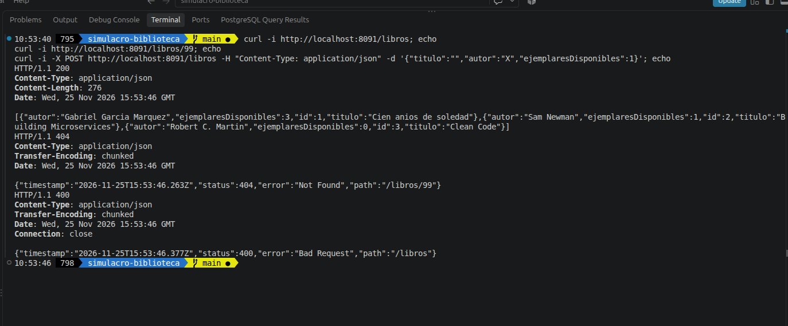
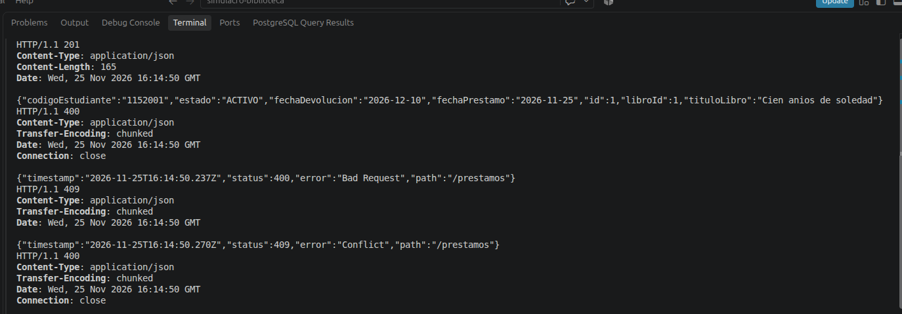

# Simulacro: Biblioteca UFPS

**Integrantes:** Camilo Andrés Sánchez Martínez (1152329) · Omar Fernando Suárez Oviedo (1152216)

**Materia:** Desarrollo de aplicaciones basadas en microservicios, UFPS

Dos microservicios en Spring Boot, cada uno con su propia base de datos H2: **Libros** (puerto 8091) y **Préstamos** (puerto 8092), comunicados por HTTP.

## Evidencias

### Pruebas de Libros

### Pruebas de Préstamos

### Libros apagado: Préstamos responde 503

## Preguntas de la defensa

### 1. ¿Por qué Préstamos tiene su propio record del libro en lugar de usar la entidad Libro?

### 2. ¿Por qué el préstamo guarda una copia del título si Libros ya lo tiene?

### 3. ¿Por qué el libro inexistente responde 400 en Préstamos y no 404?

### 4. ¿Qué cambia en la dirección de Libros cuando todo corre en Docker? ¿Por qué no hubo que tocar Java?

### 5. Préstamos no descuenta ejemplares. ¿Qué servicio debería hacerlo y qué pasa si falla justo después de guardar el préstamo?
