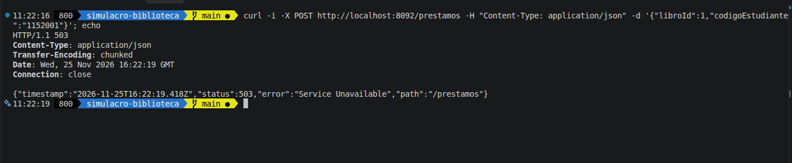

# Simulacro: Biblioteca UFPS

**Integrantes:** Camilo Andrés Sánchez Martínez (1152329) · Omar Fernando Suárez Oviedo (1152216)

**Materia:** Desarrollo de aplicaciones basadas en microservicios, UFPS

Dos microservicios en Spring Boot, cada uno con su propia base de datos H2: **Libros** (puerto 8091) y **Préstamos** (puerto 8092), comunicados por HTTP.

## Evidencias

### Pruebas de Libros

### Pruebas de Préstamos

### Libros apagado: Préstamos responde 503

## Preguntas de la defensa

### 1. ¿Por qué Préstamos tiene su propio record del libro en lugar de usar la entidad Libro?

Porque cada microservicio es independiente. Si Préstamos usara la clase `Libro` de Libros, quedarían acoplados: cualquier cambio en la entidad de Libros obligaría a cambiar y recompilar Préstamos. Con su propio record (`LibroDTO`), Préstamos solo define los campos que necesita leer del JSON que responde Libros, y cada servicio puede cambiar su código interno sin afectar al otro.

### 2. ¿Por qué el préstamo guarda una copia del título si Libros ya lo tiene?

Para no depender de Libros cada vez que se consultan los préstamos. Si Libros está caído o lento, `GET /prestamos` sigue mostrando el título del libro prestado. Además, el préstamo guarda el título como estaba al momento de prestarlo. Es una duplicación controlada de datos, común en microservicios, porque cada servicio tiene su propia base de datos.

### 3. ¿Por qué el libro inexistente responde 400 en Préstamos y no 404?

Porque el recurso de Préstamos (`/prestamos`) sí existe. Lo que está mal son los datos que envió el cliente: pidió prestar un `libroId` que no existe. Eso es una petición inválida, o sea, **400 Bad Request**. El 404 lo responde Libros a Préstamos, y Préstamos lo traduce a 400 para su propio cliente.

### 4. ¿Qué cambia en la dirección de Libros cuando todo corre en Docker? ¿Por qué no hubo que tocar Java?

Fuera de Docker, Préstamos llama a `http://localhost:8091`. Dentro de Docker, `localhost` es el propio contenedor de Préstamos, así que tiene que usar el nombre del servicio en la red de Compose: `http://libros:8091`.

No hubo que tocar Java porque la dirección está en configuración (`libros.url` en `application.properties`), no escrita en el código. Spring Boot permite reemplazarla con la variable de entorno `LIBROS_URL`, que es la que se define en el `compose.yaml`.

### 5. Préstamos no descuenta ejemplares. ¿Qué servicio debería hacerlo y qué pasa si falla justo después de guardar el préstamo?

Lo debe hacer **Libros**, porque es el dueño de ese dato: solo Libros modifica su propia base de datos. Préstamos debería pedírselo por HTTP, por ejemplo con `PATCH /libros/{id}/prestar`.

Si Préstamos guarda el préstamo y luego falla el descuento (o al revés), los datos de los dos servicios quedan inconsistentes: un préstamo sin ejemplar descontado, o un ejemplar descontado sin préstamo. Como son dos bases de datos distintas, no hay una sola transacción que pueda deshacer todo. Se soluciona con el patrón **saga con compensación**: si un paso falla, se ejecuta una acción contraria para deshacer el anterior (por ejemplo, devolver el ejemplar o marcar el préstamo como cancelado).
